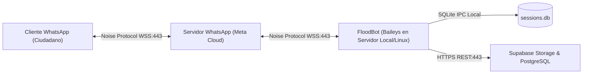
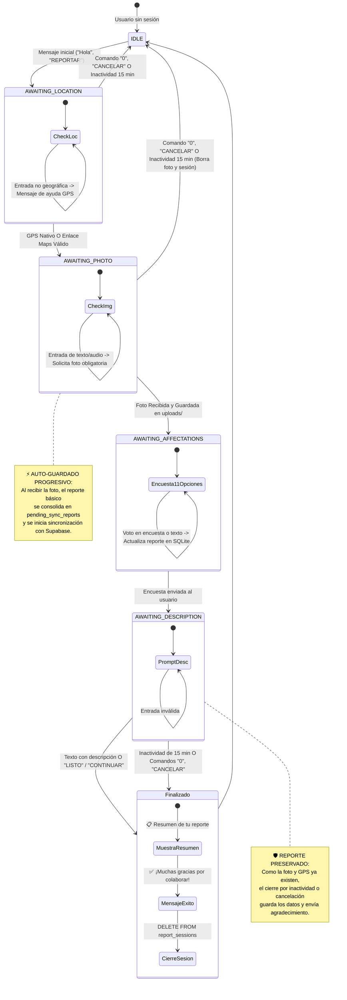
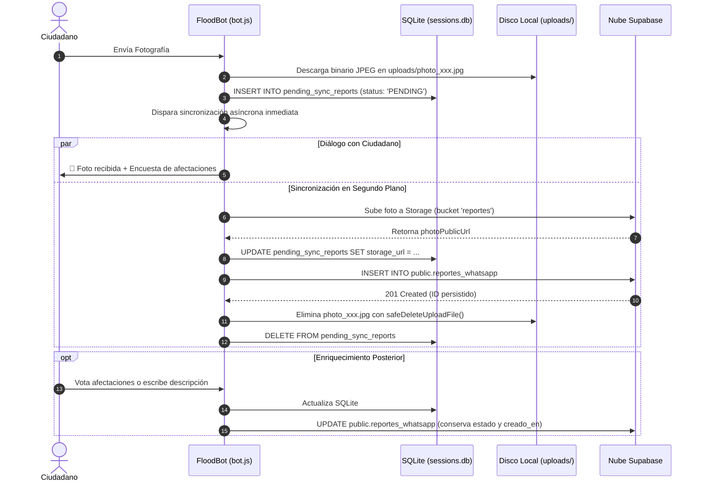
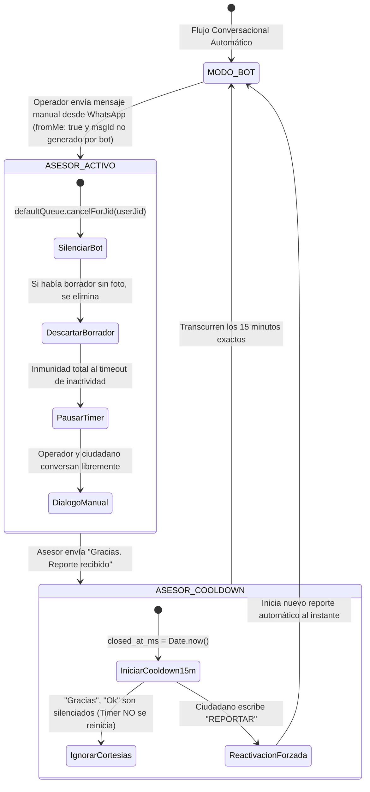

# Documentación Técnica Integral del Sistema FloodBot

**Proyecto:** Agente Conversacional Autónomo para el Monitoreo Ciudadano y Georreferenciación de Inundaciones Urbanas  
**Enfoque Académico:** Tesis de Grado en Ingeniería Mecatrónica  
**Tecnologías:** Node.js (LTS), Baileys v7, SQLite3 (better-sqlite3), Supabase (PostgreSQL + Cloud Storage)  
**Versión del Documento:** 2.0 (Actualizada con soporte de enlaces de Google Maps, auto-guardado progresivo y atención manual por asesor)

---

## 1. Resumen Ejecutivo y Alcance Mecatrónico

El proyecto **FloodBot** surge ante la necesidad de disponer de una red distribuida de sensado ciudadano que permita capturar, clasificar y geolocalizar eventos de anegamiento e inundaciones urbanas en tiempo real.

Desde el punto de vista de la **Ingeniería Mecatrónica**, los sistemas de monitoreo convencionales (estaciones meteorológicas y sensores de nivel telemétricos fijos) presentan limitaciones de cobertura espacial y altos costos de mantenimiento en cuencas urbanas complejas. FloodBot implementa el paradigma de **Sensado Humano Participativo (Crowdsensing)**, transformando cada dispositivo móvil ciudadano en un nodo sensor compuesto por:
1. **Transductor de Posición:** Receptor GNSS/GPS del teléfono inteligente o marcador de Google Maps.
2. **Sensor Óptico:** Cámara fotográfica para validación visual objetiva del anegamiento.
3. **Interfaz Humano-Máquina (HMI):** Diálogo guiado por WhatsApp para la categorización estructurada de afectaciones en la infraestructura urbana.

---

## 2. Arquitectura de Red y Protocolo de Comunicación

### 2.1 Conexión WebSocket Segura y Cero Puertos Expuestos (Zero-Attack Surface)
FloodBot opera mediante la librería de bajo nivel `@whiskeysockets/baileys`, la cual interactúa directamente con los servidores de WhatsApp utilizando el protocolo Noise/Signal sobre WebSockets seguros (`wss://web.whatsapp.com/ws/chat`, puerto 443 saliente).



* **Ventaja de Ciberseguridad:** El servidor anfitrión no abre puertos de escucha entrantes (`0.0.0.0:*`), eliminando la superficie de ataque frente a escaneos portuarios, ataques DoS y exploits HTTP.
* **Autenticación Multi-Device:** Las credenciales y claves simétricas se resguardan en disco en la carpeta `auth_info_baileys/`. Tras el emparejamiento inicial por código de 8 dígitos (*Pairing Code*), la sesión se reanuda automáticamente sin requerir interacción humana ni códigos QR.

---

## 3. Motor de Ingesta Geográfica Dual

El sistema acepta dos mecanismos complementarios para capturar la posición espacial del anegamiento:

```mermaid
flowchart TD
    Entrada["Mensaje Entrante del Ciudadano"] --> CheckTipo{"¿Tipo de Dato?"}
    CheckTipo -->|locationMessage / liveLocationMessage| ValidarGPS["Validar Coordenadas Satelitales (-90..90, -180..180)"]
    CheckTipo -->|Texto con Enlace| ExtraerURL["extractGoogleMapsUrlFromText()"]
    
    ExtraerURL --> HostPermitido{"¿Host Oficial de Google Maps?"}
    HostPermitido -->|No (Posible SSRF)| Rechazar["Solicitar Ubicación por WhatsApp"]
    HostPermitido -->|Sí| AnalizarParams{"¿Contiene Coordenadas Directas?"}
    
    AnalizarParams -->|Sí: !3d/!4d o ?q=| ExtraerCoords["Extraer Lat/Lng del Marcador"]
    AnalizarParams -->|No: Enlace Corto maps.app.goo.gl| ResolverHTTP["resolveGoogleMapsUrl() - Seguir Redirecciones HEAD/GET"]
    
    ResolverHTTP --> ExtraerCoords
    ValidarGPS --> GuardarCoord["Persistir en report_sessions"]
    ExtraerCoords --> ValidarBounds{"¿Coordenadas Válidas y Distintas de Centro Cámara /@/?"}
    ValidarBounds -->|Sí| GuardarCoord
    ValidarBounds -->|No| Rechazar
```

### 3.1 Recepción Satelital Nativa de WhatsApp
Detecta objetos `locationMessage` o `liveLocationMessage`. Las coordenadas son validadas numéricamente:
```javascript
function isValidCoordinate(lat, lng) {
    if (typeof lat !== 'number' || typeof lng !== 'number') return false
    if (isNaN(lat) || isNaN(lng) || !isFinite(lat) || !isFinite(lng)) return false
    return lat >= -90 && lat <= 90 && lng >= -180 && lng <= 180
}
```

### 3.2 Detección y Resolución de Enlaces de Google Maps
El ciudadano puede pegar enlaces directos o acortados generados desde la aplicación de Google Maps:
* **Dominios Permitidos (Mitigación de SSRF):** Se restringe la resolución de URLs únicamente a dominios oficiales: `maps.app.goo.gl`, `goo.gl`, `maps.google.com`, `*.google.com`, etc. Se descartan IPs privadas (`127.0.0.1`, `10.*`, `192.168.*`, `169.254.*`) y esquemas no seguros.
* **Priorización Estricta del Marcador de Incidente:**
  1. *Prioridad 1:* Parámetros de marcador protobuf `!3d<lat>!4d<lng>`.
  2. *Prioridad 2:* Parámetros de consulta explícitos `?q=lat,lng` o `?daddr=lat,lng`.
  3. *Prioridad 3:* Rutas de lugar `/place/<lat>,<lng>`.
  4. *Exclusión Crítica:* Se **ignoran deliberadamente** las coordenadas `/ @lat,lng,zoom /` porque representan únicamente el centro de visualización de la cámara en pantalla y no el punto geográfico del anegamiento.
* **Resolución HTTP Asíncrona:** Se ejecutan peticiones `HEAD` (o `GET` con `AbortSignal.timeout(4000)`) limitadas a un máximo de 4 saltos de redirección para enlaces cortos `maps.app.goo.gl`.

---

## 4. Máquina de Estados Finitos (FSM) y Diálogo Conversacional

El flujo conversacional se estructura bajo una máquina de estados determinista por cada usuario (`user_jid`):



### 4.1 Encuesta Nativa de 11 Afectaciones Urbanas
Para mantener compatibilidad absoluta con la plataforma web GIS, se despliegan exactamente las 11 categorías oficiales:
1. `Calle inundada`
2. `Deslizamiento`
3. `Árbol caído`
4. `Vivienda afectada`
5. `Vehículo afectado`
6. `Persona atrapada`
7. `Fallecimiento reportado`
8. `Interrupción de tránsito`
9. `Servicio público afectado`
10. `Sin daños visibles`
11. `Acumulación de basura`

---

## 5. Persistencia Progresiva y Sincronización Asíncrona Resiliente



### 5.1 Manejo de Fallos de Red y Backoff Progresivo
Si la conexión con Supabase se interrumpe durante una tormenta:
1. El reporte permanece almacenado en la tabla SQLite `pending_sync_reports`.
2. El sistema aplica un algoritmo de reintento progresivo escalonado:
   * **Intento 1:** 5 segundos
   * **Intento 2:** 15 segundos
   * **Intento 3:** 45 segundos
   * **Intento 4:** 120 segundos
   * **Intento 5+:** 300 segundos (máximo 5 minutos)
3. La fotografía física en `uploads/` **jamás se elimina** hasta que la nube confirme la subida y la inserción del registro en PostgreSQL.

---

## 6. Módulo de Atención Manual por Asesor Humano

FloodBot incorpora un sistema de intervención humana en caliente que permite a un operador o funcionario responder personalmente desde el WhatsApp vinculado sin generar conflictos con el autómata.



### 6.1 Discriminación Robusta de Ecos de Baileys (`fromMe: true`)
Cuando Baileys emite un mensaje automático, el evento `messages.upsert` de WhatsApp refleja dicho mensaje como `fromMe: true`. Si un asesor humano responde desde su teléfono, el evento también tiene `fromMe: true`.

**Solución Implementada:**
1. Todo mensaje saliente generado por el bot se registra previamente en memoria (`global.botSentMessageIds`) y en la tabla SQLite `bot_outgoing_messages`.
2. Al recibir un evento saliente:
   ```javascript
   if (msg.key.fromMe) {
       const msgId = msg.key.id
       if (!isBotOutgoingMessageId(msgId)) {
           // Proviene inequívocamente de un humano (Asesor)
           await handleAdvisorOutgoingMessage(sock, recipientJid, msg)
       }
       return
   }
   ```

### 6.2 Reglas Operativas Durante la Atención Manual
* **Silencio Absoluto:** El bot no responde preguntas ni envía recordatorios.
* **Cancelación de Cola:** Se anulan los mensajes pendientes de envío para ese destinatario en `messageQueue.js`.
* **Cero Inserciones en Supabase:** La conversación manual no se sube a Supabase; el asesor carga los datos manualmente en el portal web si corresponde.
* **Protección de Reportes Preexistentes:** Si el ciudadano ya había completado un reporte antes de la llegada del asesor, este permanece a salvo en SQLite y Supabase. Si tenía un borrador incompleto, se descarta para evitar inconsistencias.

### 6.3 Frase de Cierre y Período de Gracia Inmutable (15 Minutos)
* **Reconocimiento:** Se evalúa la frase `Gracias. Reporte recibido` normalizando tildes, mayúsculas, minúsculas y signos de puntuación:
  ```javascript
  function isAdvisorClosingMessage(text) {
      if (!text || typeof text !== 'string') return false
      const normalized = text.normalize('NFD').replace(/[\u0300-\u036f]/g, '').toLowerCase()
      return /gracias\s*[.,;!:]*\s*reporte\s+recibido/i.test(normalized)
  }
  ```
* **Comportamiento en Cooldown (15 min):**
  * Mensajes de cortesía (*"Gracias"*, *"Dale"*) son descartados en silencio sin resetear el temporizador.
  * Si el usuario escribe `REPORTAR`, el período se cancela y se inicia un nuevo reporte.
  * Al agotarse los 15 minutos, cualquier mensaje reactiva el bot con el saludo inicial.

---

## 7. Gestión de Inactividad y Limpieza de Temporales

El temporizador `cleanupExpiredSessionsAndFiles` se ejecuta periódicamente (cada 5 minutos) y al inicio del sistema:

* **Regla para Borradores Incompletos:** Si un usuario no envía la foto dentro de los 15 minutos posteriores a su último mensaje (`SESSION_TIMEOUT_MS = 15 * 60 * 1000`), la sesión se elimina, se borra cualquier archivo huérfano y se envía un mensaje de aviso:
  > *"⏱️ Conversación finalizada por inactividad. Si querés realizar un reporte, podés volver a escribir REPORTAR."*
* **Regla para Reportes Guardados:** Si el usuario ya envió foto y ubicación pero abandonó la conversación en la encuesta o descripción, el reporte **ya está seguro**. A los 15 minutos se limpia la sesión conversacional y se envía únicamente el mensaje de éxito final con el enlace a la plataforma web.
* **Protección de Asesor:** Las conversaciones en `ADVISOR_ACTIVE` están exentas de la limpieza por inactividad.

---

## 8. Diccionario de Datos y Esquemas Completos

### 8.1 SQLite Local (`sessions.db`)

```sql
-- 1. Sesiones conversacionales en curso
CREATE TABLE IF NOT EXISTS report_sessions (
    user_jid TEXT PRIMARY KEY,
    state TEXT NOT NULL,
    latitude REAL,
    longitude REAL,
    selected_affectations TEXT DEFAULT '[]',
    photo_path TEXT,
    description TEXT,
    poll_msg_id TEXT,
    poll_enc_key TEXT,
    report_id TEXT,
    storage_url TEXT,
    updated_at DATETIME DEFAULT CURRENT_TIMESTAMP
);

-- 2. Cola resiliente de reportes pendientes de sincronización
CREATE TABLE IF NOT EXISTS pending_sync_reports (
    id TEXT PRIMARY KEY,
    user_jid TEXT NOT NULL,
    latitude REAL NOT NULL,
    longitude REAL NOT NULL,
    selected_affectations TEXT DEFAULT '[]',
    photo_path TEXT,
    description TEXT,
    storage_url TEXT,
    status TEXT DEFAULT 'PENDING',
    attempts INTEGER DEFAULT 0,
    last_error TEXT,
    next_retry_at INTEGER DEFAULT 0,
    created_at DATETIME DEFAULT CURRENT_TIMESTAMP,
    updated_at DATETIME DEFAULT CURRENT_TIMESTAMP
);

-- 3. Control de atención manual por asesor y cooldown
CREATE TABLE IF NOT EXISTS advisor_sessions (
    user_jid TEXT PRIMARY KEY,
    status TEXT NOT NULL,
    started_at DATETIME DEFAULT CURRENT_TIMESTAMP,
    closed_at DATETIME,
    closed_at_ms INTEGER
);

-- 4. Registro de mensajes salientes propios del bot (Anti-Falsos Positivos)
CREATE TABLE IF NOT EXISTS bot_outgoing_messages (
    id TEXT PRIMARY KEY,
    created_at DATETIME DEFAULT CURRENT_TIMESTAMP
);

-- 5. Bitácora de auditoría y diagnóstico
CREATE TABLE IF NOT EXISTS audit_logs (
    id INTEGER PRIMARY KEY AUTOINCREMENT,
    timestamp DATETIME DEFAULT CURRENT_TIMESTAMP,
    type TEXT NOT NULL,
    message TEXT NOT NULL
);
```

### 8.2 Supabase PostgreSQL (`public.reportes_whatsapp`)

```sql
CREATE TABLE IF NOT EXISTS public.reportes_whatsapp (
    id UUID PRIMARY KEY DEFAULT gen_random_uuid(),
    telefono TEXT NOT NULL,
    latitud NUMERIC(10, 7) NOT NULL,
    longitud NUMERIC(10, 7) NOT NULL,
    foto_url TEXT NOT NULL,
    afectaciones JSONB DEFAULT '[]'::jsonb,
    descripcion TEXT,
    origen TEXT DEFAULT 'whatsapp',
    estado TEXT DEFAULT 'pendiente',
    creado_en TIMESTAMPTZ DEFAULT NOW(),
    actualizado_en TIMESTAMPTZ DEFAULT NOW()
);
```

---

## 9. Suite de Pruebas Automatizadas (52 Tests)

La batería de pruebas integral en [`test_expiration.js`](test_expiration.js) asegura el correcto funcionamiento de cada subsistema mediante entornos aislados de simulación (bases de datos temporales, mocks de socket de red y mocks de fetch HTTP).

Para ejecutar la suite completa:
```bash
npm test
```

### Matriz Temática de Cobertura:
* **FSM y Validación Geográfica (Tests 1–9, 31–40):** Coordenadas válidas/inválidas, enlaces de Google Maps cortos y largos, parámetros `q`, extracción de marcadores `!3d/!4d`, rechazo de `/ @lat,lng /`, prevención de ataques SSRF.
* **Persistencia y Progresividad (Tests 10–20, 24–30):** Descarga de fotos, auto-guardado en SQLite al recibir la foto, descarte seguro de temporales en `uploads/`, enriquecimiento progresivo de afectaciones y descripciones sin sobrescribir marcas temporales ni estado en Supabase.
* **Gestión de Inactividad (Tests 21–23, 28–29):** Comportamiento a los 15 minutos diferenciando borradores de reportes consolidados, cancelación con `0`/`CANCELAR`.
* **Atención Manual por Asesor (Tests 41–52):** Discriminación de `fromMe: true`, silenciamiento de bot, cancelación de cola de mensajes, protección contra escrituras no deseadas en Supabase, reconocimiento de `Gracias. Reporte recibido`, cooldown inmutable de 15 min, reactivación por `REPORTAR`, descarte selectivo de borradores y resguardo de reportes confirmados.

---

## 10. Manual de Operaciones y Mantenimiento 24/7 en Servidor

### 10.1 Despliegue con Gestor de Procesos PM2 (Recomendado)
Para asegurar que el proceso se reinicie automáticamente ante caídas o reinicios del sistema operativo:

```bash
# 1. Instalar PM2 de manera global
sudo npm install -g pm2

# 2. Iniciar el bot bajo supervisión de PM2
pm2 start bot.js --name "floodbot"

# 3. Guardar la configuración para el arranque del sistema
pm2 save
pm2 startup
```

### 10.2 Comandos Operativos de Supervisión
* **Ver registros en vivo:** `pm2 logs floodbot` (o `tail -f bot.log` si se usa `nohup`)
* **Estado del proceso y consumo de RAM:** `pm2 status`
* **Reiniciar el bot tras una actualización de código:** `pm2 restart floodbot`
* **Detener el bot temporalmente:** `pm2 stop floodbot`

### 10.3 Procedimiento de Respaldo y Rotación
1. **Credenciales de WhatsApp:** La carpeta `auth_info_baileys/` debe respaldarse en caso de migrar de servidor para evitar tener que volver a vincular el número telefónico.
2. **Base de Datos SQLite:** El archivo `sessions.db` almacena el histórico de auditoría y colas de sincronización. Puede respaldarse en caliente con el comando estándar de SQLite:
   ```bash
   sqlite3 sessions.db ".backup 'sessions_backup.db'"
   ```
